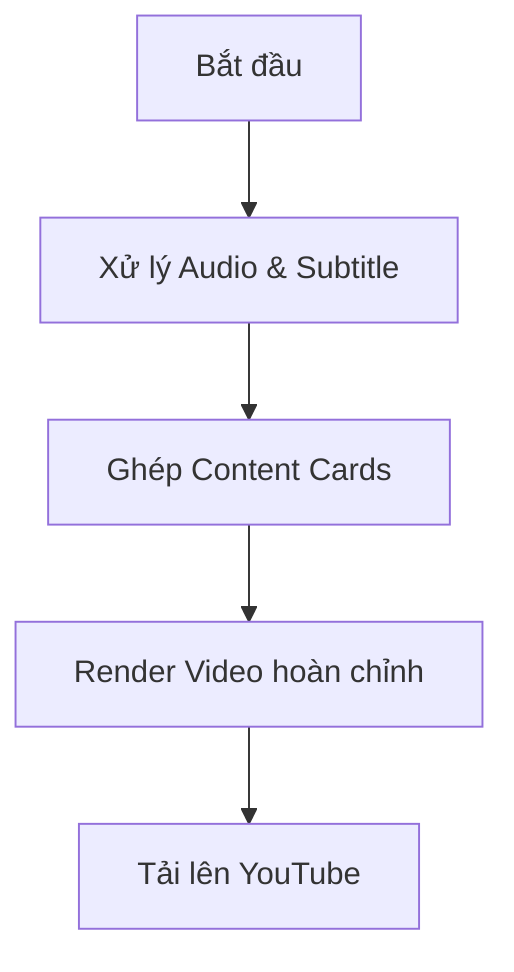

# TECHNICAL PLAN & ARCHITECTURE: [Tên Tính Năng]
**Tham chiếu Spec:** `spec.md`
**Công nghệ sử dụng:** Python 3.11, FFmpeg, Edge-TTS, GitHub Actions

---

## 1. Thiết kế kiến trúc tổng thể (Architecture Design)
- **Các thành phần bị ảnh hưởng:**
  - `pipeline.py`: ...
  - `youtube_uploader.py`: ...
  - `assets/topics/`: ...
  - `.github/workflows/`: ...

## 2. Luồng xử lý dữ liệu (Data Flow)

## 3. Đánh giá rủi ro & Phương án dự phòng (Risk Assessment)
| Rủi ro | Mức độ | Biện pháp giảm thiểu |
| :--- | :--- | :--- |
| Lỗi FFmpeg PTS / Codec trên Linux | Cao | Dùng `libx264 -preset ultrafast` để sinh monotonic timestamps |
| API Rate Limit | Trung bình | Đóng gói tài nguyên trực tiếp thay vì phụ thuộc API thời gian thực |

## 4. Cấu trúc thư mục / File thay đổi
- `[+] File mới`
- `[*] File sửa đổi`
- `[-] File xóa bỏ`
